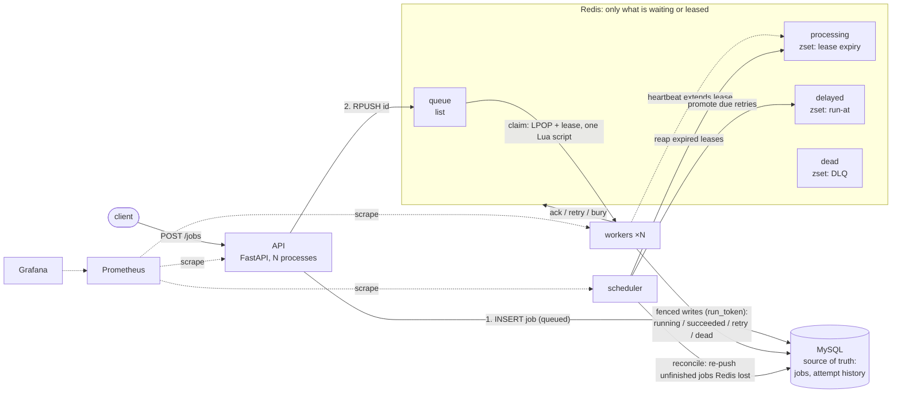

# Task Queue

[](https://github.com/bwong05umd/task-queue/actions/workflows/ci.yml)

A small Celery/Sidekiq-style job queue. A FastAPI service accepts jobs, a pool of
workers runs them in parallel, and the system survives worker crashes and Redis
or MySQL restarts without losing work. Every one of those failures is exercised
in CI.

**Stack:** Python 3.12 · FastAPI · Redis (broker) · MySQL (source of truth) ·
Prometheus + Grafana · Docker Compose · k6 · GitHub Actions.

## Architecture



A job's life: the API records it in MySQL, then pushes its id to Redis. A worker
atomically pops the id and takes a lease on it, marks the row `running` under a
fresh fencing token, runs the handler while heartbeats keep the lease alive, and
writes the outcome to MySQL before touching Redis. If the worker dies, the lease
expires and the scheduler puts the job back on the queue. Failures retry with
exponential backoff until `max_attempts`, then go to the dead-letter queue, where
they can be inspected and replayed.

## Quickstart

```bash
cp .env.example .env        # then set real passwords
docker compose up -d        # api, 3 workers, scheduler, redis, mysql, prometheus, grafana
python3 scripts/demo.py     # narrated demo: jobs, a killed worker, a DLQ replay
```

- API docs: http://localhost:8000/docs
- Grafana: http://localhost:3000 (dashboard "Task Queue"; anonymous view, admin password in `.env`)
- Prometheus: http://localhost:9090

Submit your own with `python3 scripts/submit.py 50`, and scale with
`docker compose up -d --scale worker=5`.

### Demo

`scripts/demo.py` runs four steps against the local stack and pauses between
them, so it works as a recording script:

1. Submit 30 jobs and watch them finish, including flaky ones that retry.
2. Start an 8-second job and `docker kill` its worker. The lease expires, the
   reaper requeues the job, and another worker finishes it. The attempt history
   shows `lost` and then `succeeded` on a different worker.
3. Simulate a downstream outage. An `external.call` job retries with backoff and
   lands in the dead-letter queue with every attempt's error.
4. End the outage and replay the dead job, which then succeeds.

## API

Set `API_KEY` in `.env` to require an `X-API-Key` header on every job endpoint;
`/health` and `/metrics` stay open. With `API_KEY` unset, as in local
development, auth is off. Production deploys always generate one.

| Method | Path | Purpose |
|---|---|---|
| `POST` | `/jobs` | Submit `{type, payload, max_attempts?, idempotency_key?}`. 201 new, 200 if the idempotency key was already used |
| `GET` | `/jobs/{id}` | Status, result, last error, and full `attempt_history` |
| `GET` | `/jobs?status=&type=` | List jobs |
| `GET` | `/dead-jobs?type=` | List the dead-letter queue |
| `GET` | `/dead-jobs/{id}` | Inspect one dead job with every attempt's error, traceback, worker and time |
| `POST` | `/dead-jobs/{id}/replay` | Requeue with attempts reset |
| `POST` | `/dead-jobs/replay?type=` | Bulk replay by type |
| `DELETE` | `/dead-jobs?type=` | Purge dead jobs |
| `GET` | `/health`, `/metrics` | Health (checks MySQL + Redis) and Prometheus metrics |

Sample job types: `email.send`, `image.resize`, `sleep`, `flaky` (fails the first
`fail_times` attempts), `poison` (always fails), and `external.call` (fails while
the Redis key `tq:outage` exists). Add your own in `src/taskqueue/handlers.py`
with the `@handler("name")` decorator; raise `RetryableError` or
`PermanentError` to steer retries.

## Job lifecycle

`queued → running → succeeded`, or on failure `running → queued` (retry after
backoff) until `max_attempts`, then `dead`. Permanent errors (bad payload,
unknown type, `ValueError`/`KeyError`/`TypeError`) skip retries and go straight to
`dead`. Replay moves `dead → queued`.

## Design decisions and tradeoffs

The short version; [docs/design.md](docs/design.md) has the full reasoning.

- **Redis plus MySQL, with MySQL as the truth.** Redis gives cheap atomic queue
  operations; MySQL gives durability and queryable history. When they disagree,
  MySQL wins: a reconcile pass re-pushes unfinished jobs that Redis lost, such as
  when the API crashes between the INSERT and the push, or Redis loses its last
  second of writes.
- **At-least-once delivery.** Claiming is one Lua script (pop + lease), so a crash
  right after claiming can't drop a job. The price is that a job can run twice
  when a worker stalls past its lease, so handlers must be idempotent.
  `email.send` shows the pattern: `SET NX` on the job id before the side effect.
- **Fencing tokens.** Every claim writes a fresh `run_token`; every later write is
  `WHERE run_token = :mine`. A stale worker that wakes up late can't overwrite a
  newer attempt's result.
- **MySQL first, then Redis.** A crash between the two leaves the job leased; it
  is redelivered, and the claim guard or fencing makes that harmless.
- **15 s leases, 5 s heartbeats.** A crashed worker's job restarts within about
  15 s, and a worker can miss two heartbeats before losing its lease. Shorter
  leases recover faster but cause more duplicate runs. A lost lease counts as an
  attempt, so a job that crashes its worker every time still reaches the DLQ.
- **Exponential backoff with jitter.** `2s × 2^(n-1)`, capped, plus up to 20%
  random extra, so a burst of failures doesn't retry in lockstep.
- **Dead jobs keep everything.** Every attempt's error, traceback, worker and
  time. Permanent errors skip retries but still land in the DLQ, because a human
  may want to fix and replay them.
- **Polling, not blocking, claims.** Lua scripts can't block, so idle workers poll
  every 100 ms. That's simpler lease tracking in exchange for up to 100 ms of
  pickup latency when the queue is idle.

## Tests and CI

```bash
docker compose --profile test run --rm tests      # unit + integration (real Redis/MySQL)
python3 scripts/chaos_test.py                     # failure drills against the running stack
```

The drills kill a worker mid-job, restart Redis, restart MySQL, and push a poison
job through the DLQ and back, and fail if any job is lost.

GitHub Actions ([ci.yml](.github/workflows/ci.yml)) runs on every push:

| Job | What it checks |
|---|---|
| `lint` | `ruff check` and `ruff format --check` |
| `test` | Unit and integration tests against real MySQL and Redis service containers; a skipped integration test fails the build |
| `docker` | Builds the runtime and test images |
| `e2e` | Boots the full Compose stack and runs every failure drill |

## Load testing

k6 drives `POST /jobs`; `scripts/loadtest.py` resets the stack, scales the
workers, runs a scenario, waits for the queue to drain and measures the worker
side from MySQL. Each run appends a line to `loadtest/results/results.jsonl`.

```bash
python3 scripts/loadtest.py burst  --jobs 5000 --workers 1 5 10
python3 scripts/loadtest.py steady --rate 150 --duration 3m --workers 5
python3 scripts/loadtest.py mixed  --rate 100 --duration 2m --fail-pct 10 --workers 5
python3 scripts/loadtest.py report      # every run as a markdown table
```

The runner **deletes all jobs** in the dev database before each run.

Setup: MacBook Air (Apple silicon), Colima VM with 4 CPUs and 6 GB of RAM, so
the API, workers, MySQL, Redis and k6 all share those 4 cores. Jobs are
`image.resize` (about 1 ms of CPU each). Burst runs use 50 concurrent clients.
All 107,999 jobs across these runs finished; none were lost.

| Scenario | Workers | Enqueue/s before → after | API p50 / p99 ms before → after | Worker jobs/s before → after | e2e p50 / p99 s before → after |
|---|---|---|---|---|---|
| Burst 5,000 | 1 | 632 → **1009** | 72 / 171 → 37 / 191 | 228 → 222 | 7.94 / 13.95 → 10.57 / 17.63 |
| Burst 5,000 | 5 | 514 → **853** | 89 / 189 → 49 / 156 | 496 → 361 | 0.43 / 0.81 → 4.05 / 7.99 |
| Burst 5,000 | 10 | 404 → **625** | 107 / 437 → 70 / 214 | 404 → 455 | 0.10 / 0.23 → 2.64 / 3.93 |
| Steady 150/s, 3 min | 5 | 150 → **150** | 2 / 24 → 3 / 28 | 150 → 150 | 0.04 / 0.10 → 0.04 / 0.10 |
| Mixed 100/s, 2 min, 10% failing | 5 | 100 → **100** | 2 / 15 → 3 / 43 | 90 → 90 | 0.05 / 2.71 → 0.05 / 2.73 |

**Finding the bottleneck.** In the baseline, adding workers made enqueue
throughput *fall* (632 → 404/s) while workers stayed idle and only kept pace
with the enqueue rate. Container CPU during a 10-worker burst showed the API
pinned at about one core (one Python process), with MySQL around 60% and Redis
under 10%.

**The fix, and a trap found along the way.** Running the API as 4 uvicorn
processes (`API_WORKERS`) first made things *worse*: every keep-alive request
took about 46 ms, even a 400 error that touches no database. Bisecting showed
that one process answered in 0.5 ms and two processes in 46 ms. uvicorn's
multi-process mode creates the shared listening socket with protocol 0, and
asyncio only turns on `TCP_NODELAY` for sockets that report `IPPROTO_TCP`. So
every connection kept Nagle's algorithm on, and each response waited for a
delayed ACK. The API now binds that socket itself with an explicit
`IPPROTO_TCP` (`listen_socket()` in `api.py`, with a regression test), and
keep-alive latency dropped from 46 ms to 0.5 ms.

**Result.** Burst enqueue throughput went up 55–66% (to 1,009 / 853 / 625 jobs/s
for 1 / 5 / 10 workers), and median API latency fell by about a third to a
half. Steady and mixed runs were never API-bound and are unchanged.

**What limits it now.** The workers. One worker handles about 220 jobs/s (about
4.5 ms per job: a claim script, then a 4-statement claim transaction and a
2-statement finish transaction in MySQL). With the API taking more CPU, end-to-end
latency in bursts got *longer*, because jobs now arrive faster than workers can
drain them. Median end-to-end time grows with queue position: in the baseline
1-worker burst it climbed from 1.9s for the first fifth of jobs to 13.0s
for the last fifth. On 4 shared cores, 10 workers top out around 455 jobs/s. The
next steps would be fewer MySQL round trips per job (fold the attempt-row
writes into the job update, claim in batches) and more cores.

**Retries and the DLQ under load.** In the mixed run (5% flaky, 5% poison), every
flaky job succeeded on its retry and every poison job reached the dead-letter
queue after 3 attempts (592 dead, 11,406 succeeded).
p95 end-to-end latency rose to about 2.2s because of the retry backoff, while
p50 stayed at 0.05s.

## Deploying

Any small Linux VM with SSH access works; 2 vCPUs and 2–4 GB of RAM is plenty
(for example Hetzner CX22, DigitalOcean's basic droplet, or AWS Lightsail).
Open ports 22 and 80 in its firewall.

```bash
DEPLOY_HOST=root@203.0.113.10 scripts/deploy.sh --bootstrap   # first time: installs Docker
DEPLOY_HOST=root@203.0.113.10 scripts/deploy.sh               # later deploys
```

The script ships the committed tree (`git archive HEAD`) over SSH and runs
Compose with [docker-compose.prod.yml](docker-compose.prod.yml), which:

- serves the API on port 80 with 2 API processes and 2 workers,
- keeps MySQL, Redis, Prometheus and Grafana off the public interface
  (reach the dashboards with `ssh -L 3000:localhost:3000 -L 9090:localhost:9090 root@vm`),
- turns off Grafana's anonymous access, rotates container logs, and restarts
  everything on reboot.

**Secrets:** on the first deploy the VM generates its own `.env` (database
passwords, Grafana password and an `API_KEY`) with `openssl rand`. It's
readable only by its owner and never leaves the VM; nothing secret is in the
repo. Read the key with `ssh root@vm grep API_KEY /opt/taskqueue/.env`, then:

```bash
API_URL=http://203.0.113.10 API_KEY=... python3 scripts/submit.py 20
```

## Layout

```
src/taskqueue/   api.py worker.py scheduler.py   # the three processes
                 broker.py (Redis + Lua) db.py (MySQL) policy.py (backoff, retry decisions)
                 handlers.py states.py errors.py logs.py metrics.py config.py
tests/unit/      pure logic: backoff, error classification, state transitions, log format
tests/integration/  queue, leases, fencing, retries, DLQ, reconcile, API
deploy/          mysql init, prometheus, grafana provisioning + dashboard
.github/         CI workflow
docker-compose.prod.yml  production overrides used by deploy.sh
scripts/         submit.py, demo.py, chaos_test.py, loadtest.py, deploy.sh
loadtest/        k6 scenarios (enqueue.js) and results/results.jsonl
docs/design.md   design decisions and tradeoffs
```

Configuration is environment variables; see `src/taskqueue/config.py`
(`LEASE_SECONDS`, `HEARTBEAT_SECONDS`, `DEFAULT_MAX_ATTEMPTS`, `BACKOFF_BASE`, ...).
